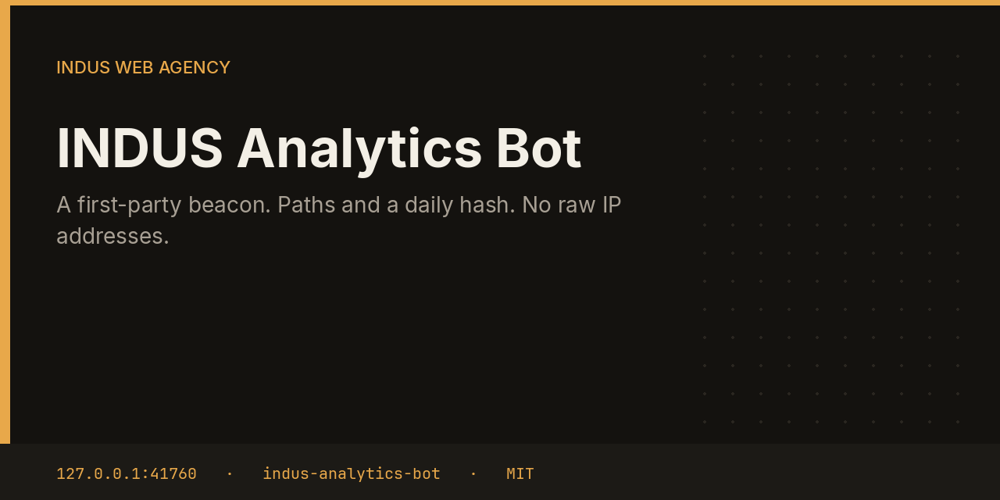

# INDUS Analytics Bot



Analytics is a first-party beacon. A hit stores the site, path, referrer, day, and a short hash of salt, day, IP, and user agent. The raw IP is not written to SQLite. An optional nginx access log can be rolled up the same way, skipping HTTP errors.

This repository is one service from the [INDUS Ops](https://github.com/mafzalkalwardev/indus-ops) monorepo, built for [INDUS Web Agency](https://induswebagency.com). The public hub is [ops.induswebagency.com](https://ops.induswebagency.com). The shared library is [indus-bot-core](https://github.com/mafzalkalwardev/indus-bot-core).

| | |
| --- | --- |
| Repository | [indus-analytics-bot](https://github.com/mafzalkalwardev/indus-analytics-bot) |
| Package | `@indus/analytics-bot` |
| Listens on | `127.0.0.1:41760` |
| Model | Local Ollama by default (`qwen2.5:3b`). No paid API is required. |
| License | [MIT](LICENSE) |

## What it does

- Builds a 20-character sha256 visitor key that changes with the day.
- Rolls hits up to path and view count.
- Can import the tail of an nginx access log, keeping path, referrer, and status under 400.
- Serves the pixel the hub publishes for product pages.

## What it will not do

- It does not store a raw IP address.
- It does not send hits to a third-party analytics vendor.
- It does not build a cross-site advertising profile.

## Place in the fleet

Add `` on a page you own. The hub shows the rollup, not the source addresses.

Commander may queue safe tasks. Scheduler is the only clock. The hub is the only login. Every service binds to `127.0.0.1`, and nginx publishes only the hub.

## Install and deploy

Install and deploy happen from the monorepo, where this folder sits next to `indus-bot-core`.

```bash
git clone https://github.com/mafzalkalwardev/indus-ops.git
cd indus-ops
npm install
npm test
npm run dev
```

`npm run dev` uses the mock model, so the board works without Ollama. On the VPS:

```bash
sudo bash deploy/install-vps.sh
```

The script installs Ollama, creates the `indus` user, writes `/opt/indus/.env`, and enables one systemd unit per service. Copy `.env.example` to `.env` only for a local run of this package. Do not commit `.env`.

To work on this package by itself, check out the monorepo (the SDK is `file:../indus-bot-core`) and from this directory run:

```bash
npm install
npm test
npm start
```

## Develop

```bash
npm test
```

Tests use Vitest. The service shell, SSO check, SQLite database, and shared LLM lock come from `@indus/bot-core`.

## Settings

Saved from the hub UI. Secrets stay in the service `.env`, never in git.

| Key | What it does |
| --- | --- |
| `nginxLog` | Optional path to an nginx access log. |

## Approval rule

Checks, drafts, renders, and analysis run on their own. Mail, campaigns, social posts, quotes that leave the building, deploys, security fixes, translation publishes, and live restores stay in the hub inbox until a person approves them. Reddit is export-only even after approval.

## License

[MIT](LICENSE). Copyright (c) 2026 Muhammad Afzal Kalwar.
