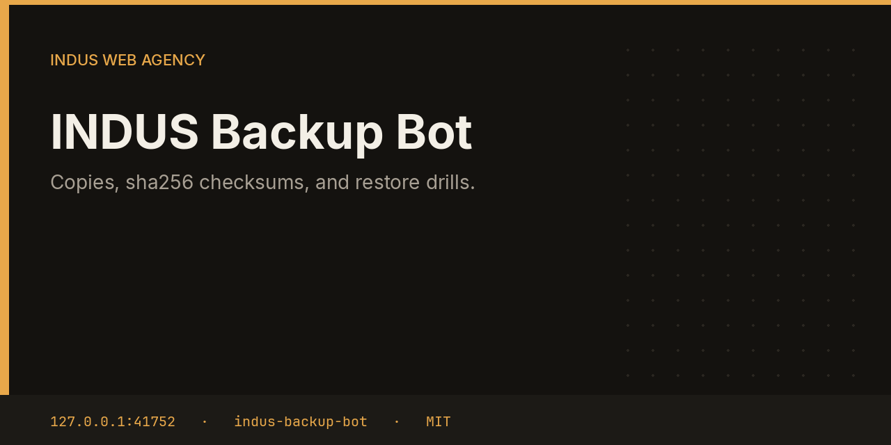

# INDUS Backup Bot



Backup copies the directories and files you name into a timestamped folder, records sha256 and size for files, and deletes older copies past the keep count. A drill checks that a copy can be read back. Overwriting live data is an approval, not a side effect of the nightly job.

This repository is one service from the [INDUS Ops](https://github.com/mafzalkalwardev/indus-ops) monorepo, built for [INDUS Web Agency](https://induswebagency.com). The public hub is [ops.induswebagency.com](https://ops.induswebagency.com). The shared library is [indus-bot-core](https://github.com/mafzalkalwardev/indus-bot-core).

| | |
| --- | --- |
| Repository | [indus-backup-bot](https://github.com/mafzalkalwardev/indus-backup-bot) |
| Package | `@indus/backup-bot` |
| Listens on | `127.0.0.1:41752` |
| Model | Local Ollama by default (`qwen2.5:3b`). No paid API is required. |
| License | [MIT](LICENSE) |

## What it does

- Copies each configured path. Directories skip `node_modules`.
- Writes a manifest of file name, sha256, and byte size.
- Optionally runs `mongodump` when a Mongo URI is set.
- Prunes older stamp directories down to the keep count.
- Runs a restore drill into the configured restore root.

## What it will not do

- It does not restore over live data unless that action was approved.
- It does not upload offsite. rclone is a later step. The suite backup script copies sqlite, `.env`, and nginx into `/opt/indus/backups`, which you should treat as secret.
- It does not claim a drill rewrote production.

## Place in the fleet

Commander may queue `backup` or `drill`. The hub card shows the latest copy and whether a drill is waiting.

Commander may queue safe tasks. Scheduler is the only clock. The hub is the only login. Every service binds to `127.0.0.1`, and nginx publishes only the hub.

## Install and deploy

Install and deploy happen from the monorepo, where this folder sits next to `indus-bot-core`.

```bash
git clone https://github.com/mafzalkalwardev/indus-ops.git
cd indus-ops
npm install
npm test
npm run dev
```

`npm run dev` uses the mock model, so the board works without Ollama. On the VPS:

```bash
sudo bash deploy/install-vps.sh
```

The script installs Ollama, creates the `indus` user, writes `/opt/indus/.env`, and enables one systemd unit per service. Copy `.env.example` to `.env` only for a local run of this package. Do not commit `.env`.

To work on this package by itself, check out the monorepo (the SDK is `file:../indus-bot-core`) and from this directory run:

```bash
npm install
npm test
npm start
```

## Develop

```bash
npm test
```

Tests use Vitest. The service shell, SSO check, SQLite database, and shared LLM lock come from `@indus/bot-core`.

## Settings

Saved from the hub UI. Secrets stay in the service `.env`, never in git.

| Key | What it does |
| --- | --- |
| `paths` | Files or directories to copy. |
| `keep` | How many timestamped copies to retain. |
| `mongoUri` | Optional URI for mongodump. |
| `restoreRoot` | Drills and restores are confined to this directory. |

## Approval rule

Checks, drafts, renders, and analysis run on their own. Mail, campaigns, social posts, quotes that leave the building, deploys, security fixes, translation publishes, and live restores stay in the hub inbox until a person approves them. Reddit is export-only even after approval.

## License

[MIT](LICENSE). Copyright (c) 2026 Muhammad Afzal Kalwar.
