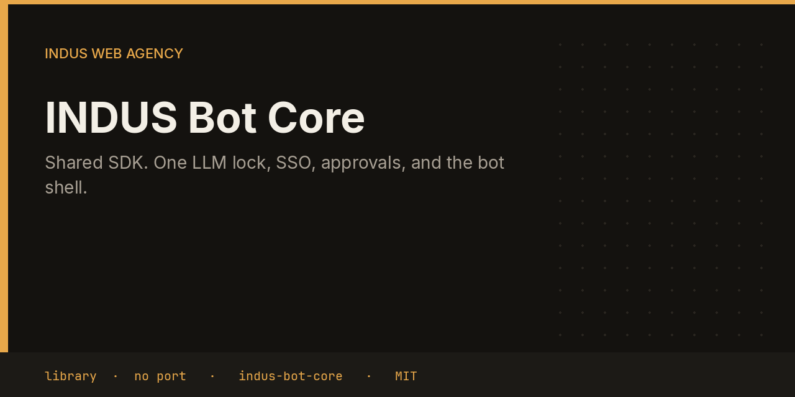

# INDUS Bot Core



indus-bot-core is the library every INDUS bot imports. It is not a service: it has no port, no nginx site, and no systemd unit. It keeps the fleet on one local model, one approval rule, and one way to draw a bot page.

This repository is the shared library from the [INDUS Ops](https://github.com/mafzalkalwardev/indus-ops) monorepo, built for [INDUS Web Agency](https://induswebagency.com). The public hub is [ops.induswebagency.com](https://ops.induswebagency.com).

| | |
| --- | --- |
| Repository | [indus-bot-core](https://github.com/mafzalkalwardev/indus-bot-core) |
| Package | `@indus/bot-core` |
| Listens on | no port of its own |
| Model | Local Ollama by default (`qwen2.5:3b`). No paid API is required. |
| License | [MIT](LICENSE) |

## What it does

- Takes a SQLite lock in `INDUS_SHARED_DIR` so only one local LLM call runs at a time, and video renders do not overlap inference.
- Talks to Ollama or an OpenAI-compatible server, and ships a mock client for tests.
- Verifies the hub SSO cookie, registers the bot, and stores approvals and the job queue.
- Renders the shared bot UI shell.
- Rejects commander tasks named publish, send, deploy, approve, restore, or apply-fix.
- Sends mail only when a bot calls `sendMail` after a person has approved that item.

## What it will not do

- It does not listen for HTTP traffic on its own.
- It does not decide that a draft is allowed to go out. The hub records that approval.
- It does not store raw secrets in the repository. Callers pass environment variables.

## Place in the fleet

On disk it is a sibling of every bot. Package manifests depend on it with `"@indus/bot-core": "file:../indus-bot-core"`. The VPS install script builds it with the rest of the tree under `/opt/indus`.

Commander may queue safe tasks. Scheduler is the only clock. The hub is the only login. Every service binds to `127.0.0.1`, and nginx publishes only the hub.

## Install and deploy

Install and deploy happen from the monorepo, where this folder sits next to `indus-bot-core`.

```bash
git clone https://github.com/mafzalkalwardev/indus-ops.git
cd indus-ops
npm install
npm test
npm run dev
```

`npm run dev` uses the mock model, so the board works without Ollama. On the VPS:

```bash
sudo bash deploy/install-vps.sh
```

The script installs Ollama, creates the `indus` user, writes `/opt/indus/.env`, and enables one systemd unit per service. Copy `.env.example` to `.env` only for a local run of this package. Do not commit `.env`.

To work on this package by itself, check out the monorepo (the SDK is `file:../indus-bot-core`) and from this directory run:

```bash
npm install
npm test
```

## Develop

```bash
npm test
```

Tests use Vitest. The service shell, SSO check, SQLite database, and shared LLM lock come from `@indus/bot-core`.

## Settings

Saved from the hub UI. Secrets stay in the service `.env`, never in git.

| Key | What it does |
| --- | --- |
| `INDUS_SHARED_DIR` | Directory for the shared SQLite LLM lock. |
| `INDUS_LLM_PROVIDER` | `ollama`, `openai-compatible`, or the test mock. |
| `LLM_MODEL` | Ollama model tag. Default in the suite is `qwen2.5:3b`. |
| `OLLAMA_BASE_URL` | Local Ollama, normally `http://127.0.0.1:11434`. |
| `INDUS_BOT_TOKEN` | Bearer token bots use when they call each other. |
| `INDUS_SSO_SECRET` | Secret that verifies the hub login cookie. |

## Approval rule

Checks, drafts, renders, and analysis run on their own. Mail, campaigns, social posts, quotes that leave the building, deploys, security fixes, translation publishes, and live restores stay in the hub inbox until a person approves them. Reddit is export-only even after approval.

## License

[MIT](LICENSE). Copyright (c) 2026 Muhammad Afzal Kalwar.
