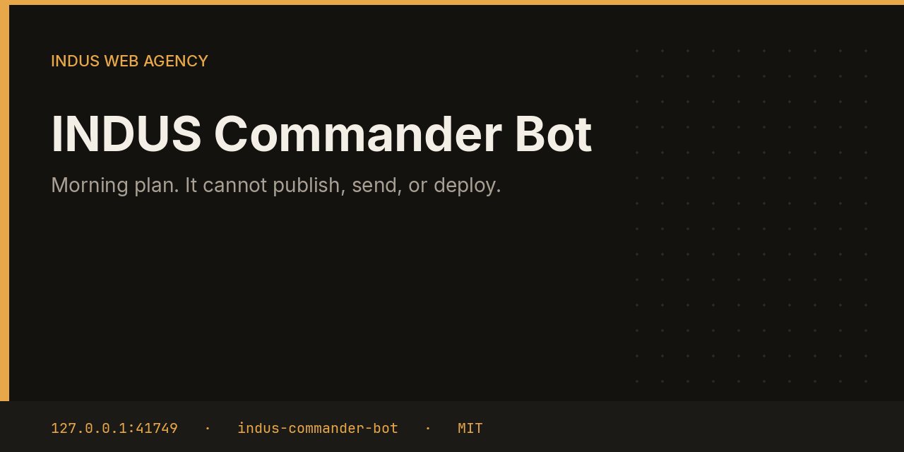
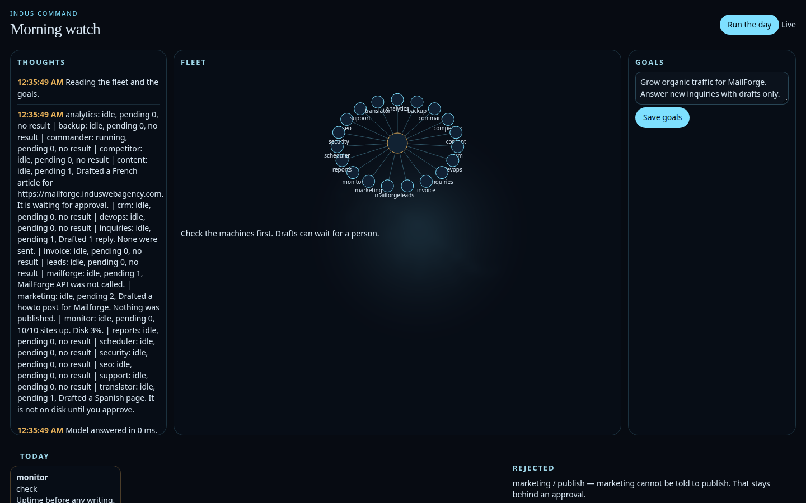

# INDUS Commander Bot



Commander reads the fleet each morning, writes a short plan, and queues internal work. The allowlist is the point: it may ask Monitor to check, SEO to audit, or Marketing to draft. Tasks named publish, send, deploy, approve, restore, or apply-fix are rejected before they are queued.

This repository is one service from the [INDUS Ops](https://github.com/mafzalkalwardev/indus-ops) monorepo, built for [INDUS Web Agency](https://induswebagency.com). The public hub is [ops.induswebagency.com](https://ops.induswebagency.com). The shared library is [indus-bot-core](https://github.com/mafzalkalwardev/indus-bot-core).

| | |
| --- | --- |
| Repository | [indus-commander-bot](https://github.com/mafzalkalwardev/indus-commander-bot) |
| Package | `@indus/commander-bot` |
| Listens on | `127.0.0.1:41749` |
| Model | Local Ollama by default (`qwen2.5:3b`). No paid API is required. |
| License | [MIT](LICENSE) |

## What it does

- Asks the local model for a plan, then runs it through `sanitizePlan`.
- Keeps only task names each bot is allowed to receive. Monitor gets `check`. Marketing gets `draft` or `render`. Security gets `audit`. Backup gets `backup` or `drill`.
- Falls back to a standing round of monitor, security, inquiries, and reports when the model suggests nothing safe.
- Shows the reasoning and the rejected lines in its own UI.

## What it will not do

- It cannot publish, send, or deploy, even if the model asks.
- It cannot approve its own suggestions. Approvals stay in the hub.
- It does not talk to customers.

## Pictures



## Place in the fleet

Scheduler runs the plan. The hub shows how many internal tasks were queued and how many were blocked.

Commander may queue safe tasks. Scheduler is the only clock. The hub is the only login. Every service binds to `127.0.0.1`, and nginx publishes only the hub.

## Install and deploy

Install and deploy happen from the monorepo, where this folder sits next to `indus-bot-core`.

```bash
git clone https://github.com/mafzalkalwardev/indus-ops.git
cd indus-ops
npm install
npm test
npm run dev
```

`npm run dev` uses the mock model, so the board works without Ollama. On the VPS:

```bash
sudo bash deploy/install-vps.sh
```

The script installs Ollama, creates the `indus` user, writes `/opt/indus/.env`, and enables one systemd unit per service. Copy `.env.example` to `.env` only for a local run of this package. Do not commit `.env`.

To work on this package by itself, check out the monorepo (the SDK is `file:../indus-bot-core`) and from this directory run:

```bash
npm install
npm test
npm start
```

## Develop

```bash
npm test
```

Tests use Vitest. The service shell, SSO check, SQLite database, and shared LLM lock come from `@indus/bot-core`.

## Settings

Saved from the hub UI. Secrets stay in the service `.env`, never in git.

| Key | What it does |
| --- | --- |
| `goals` | One goal per line. The morning plan is written against these. |

## Approval rule

Checks, drafts, renders, and analysis run on their own. Mail, campaigns, social posts, quotes that leave the building, deploys, security fixes, translation publishes, and live restores stay in the hub inbox until a person approves them. Reddit is export-only even after approval.

## License

[MIT](LICENSE). Copyright (c) 2026 Muhammad Afzal Kalwar.
