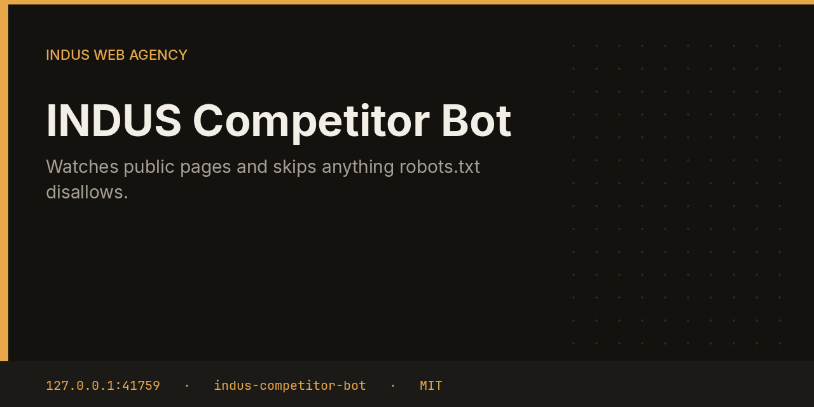

# INDUS Competitor Bot



Competitor fetches each URL you list, but only after reading that origin's `robots.txt`. A disallow for the path skips the page. Allowed pages are hashed, and a change becomes a note in the inbox with a short summary.

This repository is one service from the [INDUS Ops](https://github.com/mafzalkalwardev/indus-ops) monorepo, built for [INDUS Web Agency](https://induswebagency.com). The public hub is [ops.induswebagency.com](https://ops.induswebagency.com). The shared library is [indus-bot-core](https://github.com/mafzalkalwardev/indus-bot-core).

| | |
| --- | --- |
| Repository | [indus-competitor-bot](https://github.com/mafzalkalwardev/indus-competitor-bot) |
| Package | `@indus/competitor-bot` |
| Listens on | `127.0.0.1:41759` |
| Model | Local Ollama by default (`qwen2.5:3b`). No paid API is required. |
| License | [MIT](LICENSE) |

## What it does

- Parses `User-agent: *` disallow rules and skips a path those rules cover.
- Waits briefly between pages.
- Stores a whitespace-normalized sha256 and a short excerpt.
- Asks the local model to summarize real changes, and files a `note` approval.

## What it will not do

- It does not ignore robots.txt.
- It does not log into a competitor site or use a private API.
- It does not invent prices it did not read.

## Place in the fleet

The hub shows the watch list and the latest change note. Nothing here posts, emails, or changes your sites.

Commander may queue safe tasks. Scheduler is the only clock. The hub is the only login. Every service binds to `127.0.0.1`, and nginx publishes only the hub.

## Install and deploy

Install and deploy happen from the monorepo, where this folder sits next to `indus-bot-core`.

```bash
git clone https://github.com/mafzalkalwardev/indus-ops.git
cd indus-ops
npm install
npm test
npm run dev
```

`npm run dev` uses the mock model, so the board works without Ollama. On the VPS:

```bash
sudo bash deploy/install-vps.sh
```

The script installs Ollama, creates the `indus` user, writes `/opt/indus/.env`, and enables one systemd unit per service. Copy `.env.example` to `.env` only for a local run of this package. Do not commit `.env`.

To work on this package by itself, check out the monorepo (the SDK is `file:../indus-bot-core`) and from this directory run:

```bash
npm install
npm test
npm start
```

## Develop

```bash
npm test
```

Tests use Vitest. The service shell, SSO check, SQLite database, and shared LLM lock come from `@indus/bot-core`.

## Settings

Saved from the hub UI. Secrets stay in the service `.env`, never in git.

| Key | What it does |
| --- | --- |
| `pages` | Public URLs to watch. |

## Approval rule

Checks, drafts, renders, and analysis run on their own. Mail, campaigns, social posts, quotes that leave the building, deploys, security fixes, translation publishes, and live restores stay in the hub inbox until a person approves them. Reddit is export-only even after approval.

## License

[MIT](LICENSE). Copyright (c) 2026 Muhammad Afzal Kalwar.
