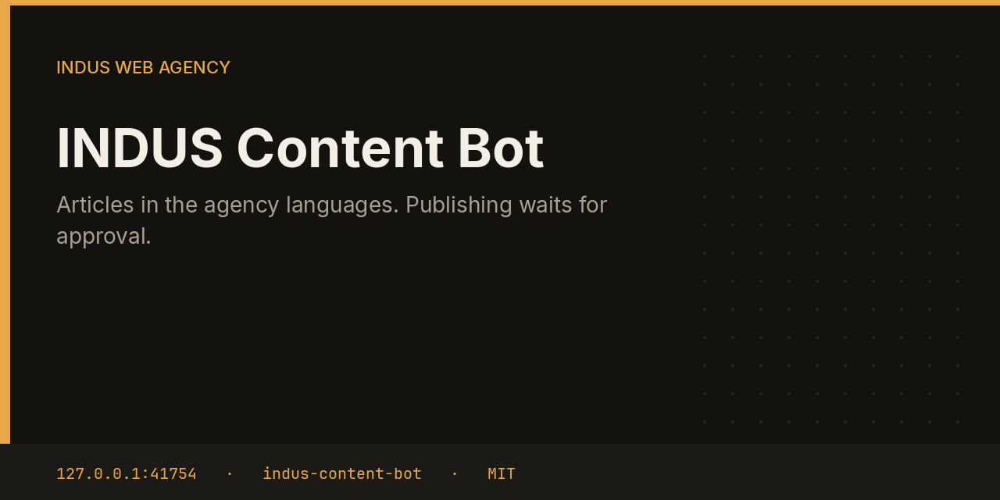

# INDUS Content Bot



Content drafts one article at a time for a product URL, rotating the agency languages: English, Spanish, French, Urdu, Punjabi, Sindhi, and Haitian Creole. The brief asks for a job-to-be-done headline, a 150-character description, and three internal links. The article is an approval, not a publish.

This repository is one service from the [INDUS Ops](https://github.com/mafzalkalwardev/indus-ops) monorepo, built for [INDUS Web Agency](https://induswebagency.com). The public hub is [ops.induswebagency.com](https://ops.induswebagency.com). The shared library is [indus-bot-core](https://github.com/mafzalkalwardev/indus-bot-core).

| | |
| --- | --- |
| Repository | [indus-content-bot](https://github.com/mafzalkalwardev/indus-content-bot) |
| Package | `@indus/content-bot` |
| Listens on | `127.0.0.1:41754` |
| Model | Local Ollama by default (`qwen2.5:3b`). No paid API is required. |
| License | [MIT](LICENSE) |

## What it does

- Picks a product from the configured list and a language from the day.
- Asks the local model for title, description, and body.
- Files a `blog_post` approval tagged with the language code.
- Offers the same draft to the SEO and Marketing bots on their internal ingest routes when those URLs are set.

## What it will not do

- It does not publish the article to a CMS.
- It does not claim a post went live.
- It does not send the article by email.

## Place in the fleet

SEO can audit the page the article is about. Marketing can turn an approved article into a social draft. Translator handles hreflang pages separately.

Commander may queue safe tasks. Scheduler is the only clock. The hub is the only login. Every service binds to `127.0.0.1`, and nginx publishes only the hub.

## Install and deploy

Install and deploy happen from the monorepo, where this folder sits next to `indus-bot-core`.

```bash
git clone https://github.com/mafzalkalwardev/indus-ops.git
cd indus-ops
npm install
npm test
npm run dev
```

`npm run dev` uses the mock model, so the board works without Ollama. On the VPS:

```bash
sudo bash deploy/install-vps.sh
```

The script installs Ollama, creates the `indus` user, writes `/opt/indus/.env`, and enables one systemd unit per service. Copy `.env.example` to `.env` only for a local run of this package. Do not commit `.env`.

To work on this package by itself, check out the monorepo (the SDK is `file:../indus-bot-core`) and from this directory run:

```bash
npm install
npm test
npm start
```

## Develop

```bash
npm test
```

Tests use Vitest. The service shell, SSO check, SQLite database, and shared LLM lock come from `@indus/bot-core`.

## Settings

Saved from the hub UI. Secrets stay in the service `.env`, never in git.

| Key | What it does |
| --- | --- |
| `products` | Product URLs the articles should support. |

## Approval rule

Checks, drafts, renders, and analysis run on their own. Mail, campaigns, social posts, quotes that leave the building, deploys, security fixes, translation publishes, and live restores stay in the hub inbox until a person approves them. Reddit is export-only even after approval.

## License

[MIT](LICENSE). Copyright (c) 2026 Muhammad Afzal Kalwar.
