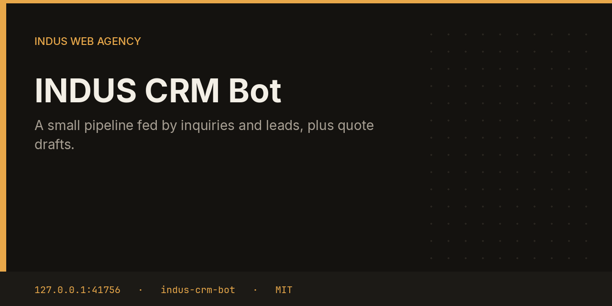

# INDUS CRM Bot



CRM keeps clients in SQLite and moves them through new, qualified, proposal, won, and lost. It reads approvals from Inquiries and Leads, then drafts a quote when a follow-up is due. The quote is not emailed.

This repository is one service from the [INDUS Ops](https://github.com/mafzalkalwardev/indus-ops) monorepo, built for [INDUS Web Agency](https://induswebagency.com). The public hub is [ops.induswebagency.com](https://ops.induswebagency.com). The shared library is [indus-bot-core](https://github.com/mafzalkalwardev/indus-bot-core).

| | |
| --- | --- |
| Repository | [indus-crm-bot](https://github.com/mafzalkalwardev/indus-crm-bot) |
| Package | `@indus/crm-bot` |
| Listens on | `127.0.0.1:41756` |
| Model | Local Ollama by default (`qwen2.5:3b`). No paid API is required. |
| License | [MIT](LICENSE) |

## What it does

- Inserts a client row from each inquiry or lead approval it can see, without duplicating the email key.
- Treats a proposal-stage contact as due after 3 days, and other open stages after 5. Won and lost are never due.
- Asks the local model for a short quote and files a `quote` approval.

## What it will not do

- It does not send the quote.
- It does not take payment. Invoices are a different bot, and that bot has no payment processor either.
- It does not invent a contact when the fleet is unreachable. It keeps the rows it already has.

## Place in the fleet

Inquiries and Leads are the inputs. Invoice can turn an approved quote into a PDF later. The hub shows the stage and the waiting draft.

Commander may queue safe tasks. Scheduler is the only clock. The hub is the only login. Every service binds to `127.0.0.1`, and nginx publishes only the hub.

## Install and deploy

Install and deploy happen from the monorepo, where this folder sits next to `indus-bot-core`.

```bash
git clone https://github.com/mafzalkalwardev/indus-ops.git
cd indus-ops
npm install
npm test
npm run dev
```

`npm run dev` uses the mock model, so the board works without Ollama. On the VPS:

```bash
sudo bash deploy/install-vps.sh
```

The script installs Ollama, creates the `indus` user, writes `/opt/indus/.env`, and enables one systemd unit per service. Copy `.env.example` to `.env` only for a local run of this package. Do not commit `.env`.

To work on this package by itself, check out the monorepo (the SDK is `file:../indus-bot-core`) and from this directory run:

```bash
npm install
npm test
npm start
```

## Develop

```bash
npm test
```

Tests use Vitest. The service shell, SSO check, SQLite database, and shared LLM lock come from `@indus/bot-core`.

## Approval rule

Checks, drafts, renders, and analysis run on their own. Mail, campaigns, social posts, quotes that leave the building, deploys, security fixes, translation publishes, and live restores stay in the hub inbox until a person approves them. Reddit is export-only even after approval.

## License

[MIT](LICENSE). Copyright (c) 2026 Muhammad Afzal Kalwar.
