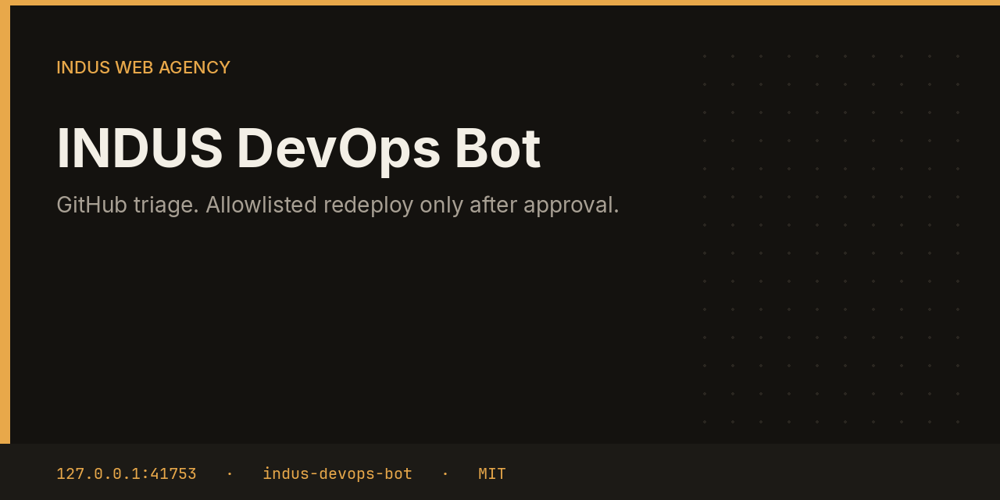

# INDUS DevOps Bot



DevOps lists the GitHub user's recently updated repositories and the open-issue counts. If you configured an allowlisted target, it proposes a redeploy. Approval runs `git pull --ff-only` in that directory and `systemctl restart` for that unit, and only that unit.

This repository is one service from the [INDUS Ops](https://github.com/mafzalkalwardev/indus-ops) monorepo, built for [INDUS Web Agency](https://induswebagency.com). The public hub is [ops.induswebagency.com](https://ops.induswebagency.com). The shared library is [indus-bot-core](https://github.com/mafzalkalwardev/indus-bot-core).

| | |
| --- | --- |
| Repository | [indus-devops-bot](https://github.com/mafzalkalwardev/indus-devops-bot) |
| Package | `@indus/devops-bot` |
| Listens on | `127.0.0.1:41753` |
| Model | Local Ollama by default (`qwen2.5:3b`). No paid API is required. |
| License | [MIT](LICENSE) |

## What it does

- Calls the GitHub REST API for the configured user. Public repositories work without a token.
- Summarizes up to eight repositories with their open-issue counts.
- Files a `deploy` approval naming the allowlisted key and branch.
- On approval, checks the branch, the unit name, and that the path does not contain `..` before it pulls and restarts.

## What it will not do

- It will not deploy a target that is not in the allowlist.
- It will not force-push, reset, or restart a unit whose name fails the safe pattern.
- It does not merge pull requests.

## Place in the fleet

The hub shows open issue pressure and any redeploy waiting for you. Commander may queue `triage`. It may not queue `deploy`.

Commander may queue safe tasks. Scheduler is the only clock. The hub is the only login. Every service binds to `127.0.0.1`, and nginx publishes only the hub.

## Install and deploy

Install and deploy happen from the monorepo, where this folder sits next to `indus-bot-core`.

```bash
git clone https://github.com/mafzalkalwardev/indus-ops.git
cd indus-ops
npm install
npm test
npm run dev
```

`npm run dev` uses the mock model, so the board works without Ollama. On the VPS:

```bash
sudo bash deploy/install-vps.sh
```

The script installs Ollama, creates the `indus` user, writes `/opt/indus/.env`, and enables one systemd unit per service. Copy `.env.example` to `.env` only for a local run of this package. Do not commit `.env`.

To work on this package by itself, check out the monorepo (the SDK is `file:../indus-bot-core`) and from this directory run:

```bash
npm install
npm test
npm start
```

## Develop

```bash
npm test
```

Tests use Vitest. The service shell, SSO check, SQLite database, and shared LLM lock come from `@indus/bot-core`.

## Settings

Saved from the hub UI. Secrets stay in the service `.env`, never in git.

| Key | What it does |
| --- | --- |
| `user` | GitHub login. Default `mafzalkalwardev`. |
| `token` | Optional token for private repositories and higher rate limits. |
| `targets` | Allowlist of `{ key, cwd, service }` redeploy targets. |

## Approval rule

Checks, drafts, renders, and analysis run on their own. Mail, campaigns, social posts, quotes that leave the building, deploys, security fixes, translation publishes, and live restores stay in the hub inbox until a person approves them. Reddit is export-only even after approval.

## License

[MIT](LICENSE). Copyright (c) 2026 Muhammad Afzal Kalwar.
