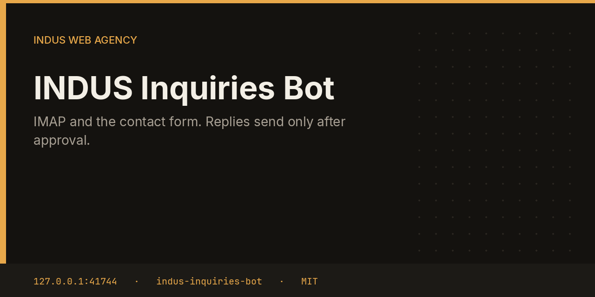

# INDUS Inquiries Bot



Inquiries watches a mailbox and the public contact form, classifies each note as sales, support, spam, partnership, or other, and drafts a reply. The draft sits in the hub until you approve it. Only then does SMTP send.

This repository is one service from the [INDUS Ops](https://github.com/mafzalkalwardev/indus-ops) monorepo, built for [INDUS Web Agency](https://induswebagency.com). The public hub is [ops.induswebagency.com](https://ops.induswebagency.com). The shared library is [indus-bot-core](https://github.com/mafzalkalwardev/indus-bot-core).

| | |
| --- | --- |
| Repository | [indus-inquiries-bot](https://github.com/mafzalkalwardev/indus-inquiries-bot) |
| Package | `@indus/inquiries-bot` |
| Listens on | `127.0.0.1:41744` |
| Model | Local Ollama by default (`qwen2.5:3b`). No paid API is required. |
| License | [MIT](LICENSE) |

## What it does

- Stores messages in a local inbox table keyed by source and external id.
- Classifies with a small rule set, then asks the local model for a reply subject and body.
- Files an `inquiry_reply` approval addressed to the sender.
- Accepts the contact webhook the hub exposes at `/api/hooks/contact`.
- Sends through the suite SMTP settings after approval.

## What it will not do

- It never says a reply was sent while it is still drafting.
- It does not send spam replies. Spam is classified and left for you.
- It does not store the IMAP password in the repository.

## Place in the fleet

Support escalates widget conversations here. CRM reads inquiry approvals when it builds the pipeline. Point forms at `https://ops.induswebagency.com/api/hooks/contact` with header `X-Indus-Webhook-Secret` or field `secret`.

Commander may queue safe tasks. Scheduler is the only clock. The hub is the only login. Every service binds to `127.0.0.1`, and nginx publishes only the hub.

## Install and deploy

Install and deploy happen from the monorepo, where this folder sits next to `indus-bot-core`.

```bash
git clone https://github.com/mafzalkalwardev/indus-ops.git
cd indus-ops
npm install
npm test
npm run dev
```

`npm run dev` uses the mock model, so the board works without Ollama. On the VPS:

```bash
sudo bash deploy/install-vps.sh
```

The script installs Ollama, creates the `indus` user, writes `/opt/indus/.env`, and enables one systemd unit per service. Copy `.env.example` to `.env` only for a local run of this package. Do not commit `.env`.

To work on this package by itself, check out the monorepo (the SDK is `file:../indus-bot-core`) and from this directory run:

```bash
npm install
npm test
npm start
```

## Develop

```bash
npm test
```

Tests use Vitest. The service shell, SSO check, SQLite database, and shared LLM lock come from `@indus/bot-core`.

## Settings

Saved from the hub UI. Secrets stay in the service `.env`, never in git.

| Key | What it does |
| --- | --- |
| `imapHost` | IMAP hostname. |
| `imapPort` | IMAP port. |
| `imapUser` | IMAP username. |
| `imapPass` | IMAP password. |
| `webhookSecret` | Shared secret for the contact form. |

## Approval rule

Checks, drafts, renders, and analysis run on their own. Mail, campaigns, social posts, quotes that leave the building, deploys, security fixes, translation publishes, and live restores stay in the hub inbox until a person approves them. Reddit is export-only even after approval.

## License

[MIT](LICENSE). Copyright (c) 2026 Muhammad Afzal Kalwar.
