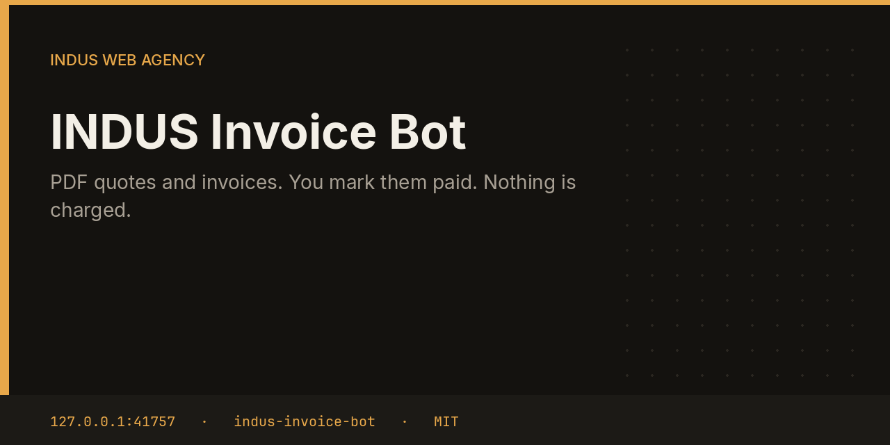

# INDUS Invoice Bot



Invoice stores quotes and invoices locally and can build a one-page PDF with Helvetica text. Numbers look like `Q-0001` and `INV-0001`. Totals are quantity times price. Nothing is charged, and no card data is collected.

This repository is one service from the [INDUS Ops](https://github.com/mafzalkalwardev/indus-ops) monorepo, built for [INDUS Web Agency](https://induswebagency.com). The public hub is [ops.induswebagency.com](https://ops.induswebagency.com). The shared library is [indus-bot-core](https://github.com/mafzalkalwardev/indus-bot-core).

| | |
| --- | --- |
| Repository | [indus-invoice-bot](https://github.com/mafzalkalwardev/indus-invoice-bot) |
| Package | `@indus/invoice-bot` |
| Listens on | `127.0.0.1:41757` |
| Model | Local Ollama by default (`qwen2.5:3b`). No paid API is required. |
| License | [MIT](LICENSE) |

## What it does

- Stores kind, number, client, total, and status in SQLite.
- Builds a PDF 1.4 document in memory for a quote or an invoice.
- Reports open and paid totals on each run.

## What it will not do

- It does not connect to Stripe, PayPal, or a bank.
- It does not email the PDF by itself.
- It does not mark an invoice paid because time passed. A person does that.

## Place in the fleet

CRM drafts the words of a quote. This bot is the document. The hub states that payment is manual.

Commander may queue safe tasks. Scheduler is the only clock. The hub is the only login. Every service binds to `127.0.0.1`, and nginx publishes only the hub.

## Install and deploy

Install and deploy happen from the monorepo, where this folder sits next to `indus-bot-core`.

```bash
git clone https://github.com/mafzalkalwardev/indus-ops.git
cd indus-ops
npm install
npm test
npm run dev
```

`npm run dev` uses the mock model, so the board works without Ollama. On the VPS:

```bash
sudo bash deploy/install-vps.sh
```

The script installs Ollama, creates the `indus` user, writes `/opt/indus/.env`, and enables one systemd unit per service. Copy `.env.example` to `.env` only for a local run of this package. Do not commit `.env`.

To work on this package by itself, check out the monorepo (the SDK is `file:../indus-bot-core`) and from this directory run:

```bash
npm install
npm test
npm start
```

## Develop

```bash
npm test
```

Tests use Vitest. The service shell, SSO check, SQLite database, and shared LLM lock come from `@indus/bot-core`.

## Approval rule

Checks, drafts, renders, and analysis run on their own. Mail, campaigns, social posts, quotes that leave the building, deploys, security fixes, translation publishes, and live restores stay in the hub inbox until a person approves them. Reddit is export-only even after approval.

## License

[MIT](LICENSE). Copyright (c) 2026 Muhammad Afzal Kalwar.
