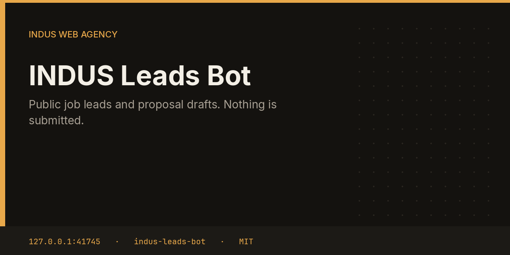

# INDUS Leads Bot



Leads reads public listings that already allow automated access, scores them for the kind of work INDUS takes, and drafts at most a couple of proposals. The draft is an approval. This bot does not log into Upwork or submit a bid.

This repository is one service from the [INDUS Ops](https://github.com/mafzalkalwardev/indus-ops) monorepo, built for [INDUS Web Agency](https://induswebagency.com). The public hub is [ops.induswebagency.com](https://ops.induswebagency.com). The shared library is [indus-bot-core](https://github.com/mafzalkalwardev/indus-bot-core).

| | |
| --- | --- |
| Repository | [indus-leads-bot](https://github.com/mafzalkalwardev/indus-leads-bot) |
| Package | `@indus/leads-bot` |
| Listens on | `127.0.0.1:41745` |
| Model | Local Ollama by default (`qwen2.5:3b`). No paid API is required. |
| License | [MIT](LICENSE) |

## What it does

- Pulls Remotive software jobs and the We Work Remotely programming RSS feed.
- Scores React, Next.js, SEO, automation, and general web work higher, and unpaid or internship posts lower.
- Skips anything under the score line (the default interest line in the task is 40).
- Dedupes on hostname plus path, or on the title when the URL is missing.
- Files a `lead_proposal` approval with the source, score, and draft.

## What it will not do

- It does not claim a proposal was sent.
- It does not call an Upwork API in this build.
- It does not invent a private job board. Sources are the two public feeds above.

## Place in the fleet

CRM can pick up lead approvals as new pipeline rows. You send the proposal yourself, or a later approved action does, from the hub.

Commander may queue safe tasks. Scheduler is the only clock. The hub is the only login. Every service binds to `127.0.0.1`, and nginx publishes only the hub.

## Install and deploy

Install and deploy happen from the monorepo, where this folder sits next to `indus-bot-core`.

```bash
git clone https://github.com/mafzalkalwardev/indus-ops.git
cd indus-ops
npm install
npm test
npm run dev
```

`npm run dev` uses the mock model, so the board works without Ollama. On the VPS:

```bash
sudo bash deploy/install-vps.sh
```

The script installs Ollama, creates the `indus` user, writes `/opt/indus/.env`, and enables one systemd unit per service. Copy `.env.example` to `.env` only for a local run of this package. Do not commit `.env`.

To work on this package by itself, check out the monorepo (the SDK is `file:../indus-bot-core`) and from this directory run:

```bash
npm install
npm test
npm start
```

## Develop

```bash
npm test
```

Tests use Vitest. The service shell, SSO check, SQLite database, and shared LLM lock come from `@indus/bot-core`.

## Settings

Saved from the hub UI. Secrets stay in the service `.env`, never in git.

| Key | What it does |
| --- | --- |
| `minScore` | Minimum score before a listing becomes a draft. |

## Approval rule

Checks, drafts, renders, and analysis run on their own. Mail, campaigns, social posts, quotes that leave the building, deploys, security fixes, translation publishes, and live restores stay in the hub inbox until a person approves them. Reddit is export-only even after approval.

## License

[MIT](LICENSE). Copyright (c) 2026 Muhammad Afzal Kalwar.
