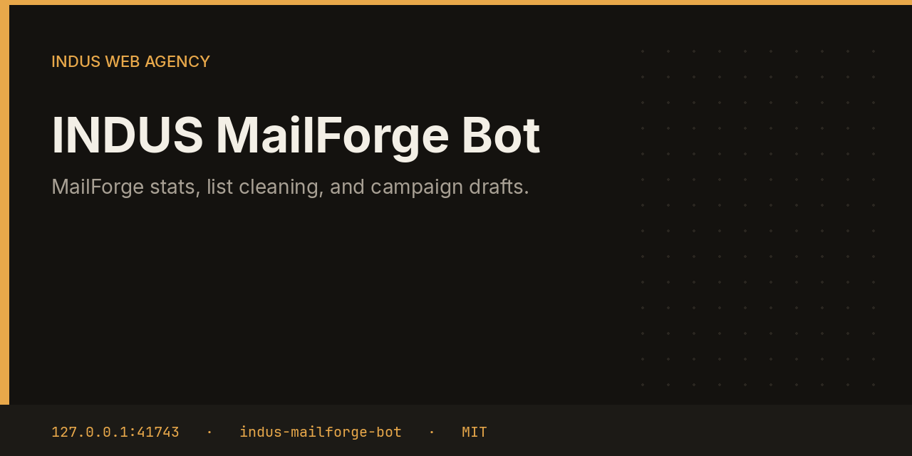

# INDUS MailForge Bot



MailForge Bot signs in to a local MailForge install, reads the dashboard overview and the latest bulk job, and drops disposable or duplicate addresses. It drafts a campaign with `{Name}` and `{SENDER_NAME}` and will not schedule it until you approve a future time and a real list is attached.

This repository is one service from the [INDUS Ops](https://github.com/mafzalkalwardev/indus-ops) monorepo, built for [INDUS Web Agency](https://induswebagency.com). The public hub is [ops.induswebagency.com](https://ops.induswebagency.com). The shared library is [indus-bot-core](https://github.com/mafzalkalwardev/indus-bot-core).

| | |
| --- | --- |
| Repository | [indus-mailforge-bot](https://github.com/mafzalkalwardev/indus-mailforge-bot) |
| Package | `@indus/mailforge-bot` |
| Listens on | `127.0.0.1:41743` |
| Model | Local Ollama by default (`qwen2.5:3b`). No paid API is required. |
| License | [MIT](LICENSE) |

## What it does

- Logs in to MailForge at the configured base URL, default `http://127.0.0.1:5000`.
- Pulls `/api/dashboard/overview` and the newest bulk-job id when login works.
- Keeps syntactically valid, unique addresses and drops disposable domains such as mailinator and yopmail.
- Files a `mailforge_campaign` approval with the subject and body.
- On approval, schedules only if `scheduledAt` is in the future and a bulk job id is present.

## What it will not do

- It will not send a campaign because a draft exists. Missing credentials, a missing list, or a missing future time save the copy and stop.
- It does not replace SMTP for inquiry replies. Those go through the Inquiries bot.
- It does not commit the MailForge password. That stays in settings.

## Place in the fleet

The hub card shows whether the MailForge API was reached. Reports can include that summary the next morning.

Commander may queue safe tasks. Scheduler is the only clock. The hub is the only login. Every service binds to `127.0.0.1`, and nginx publishes only the hub.

## Install and deploy

Install and deploy happen from the monorepo, where this folder sits next to `indus-bot-core`.

```bash
git clone https://github.com/mafzalkalwardev/indus-ops.git
cd indus-ops
npm install
npm test
npm run dev
```

`npm run dev` uses the mock model, so the board works without Ollama. On the VPS:

```bash
sudo bash deploy/install-vps.sh
```

The script installs Ollama, creates the `indus` user, writes `/opt/indus/.env`, and enables one systemd unit per service. Copy `.env.example` to `.env` only for a local run of this package. Do not commit `.env`.

To work on this package by itself, check out the monorepo (the SDK is `file:../indus-bot-core`) and from this directory run:

```bash
npm install
npm test
npm start
```

## Develop

```bash
npm test
```

Tests use Vitest. The service shell, SSO check, SQLite database, and shared LLM lock come from `@indus/bot-core`.

## Settings

Saved from the hub UI. Secrets stay in the service `.env`, never in git.

| Key | What it does |
| --- | --- |
| `baseUrl` | MailForge origin. Default `http://127.0.0.1:5000`. |
| `email` | MailForge login email. |
| `password` | MailForge password. |
| `mongoUri` | Optional read-only Mongo fallback. |

## Approval rule

Checks, drafts, renders, and analysis run on their own. Mail, campaigns, social posts, quotes that leave the building, deploys, security fixes, translation publishes, and live restores stay in the hub inbox until a person approves them. Reddit is export-only even after approval.

## License

[MIT](LICENSE). Copyright (c) 2026 Muhammad Afzal Kalwar.
