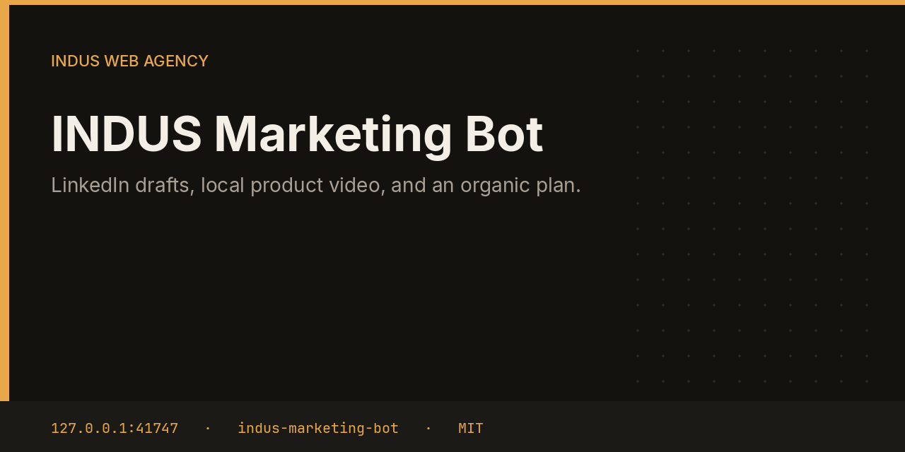
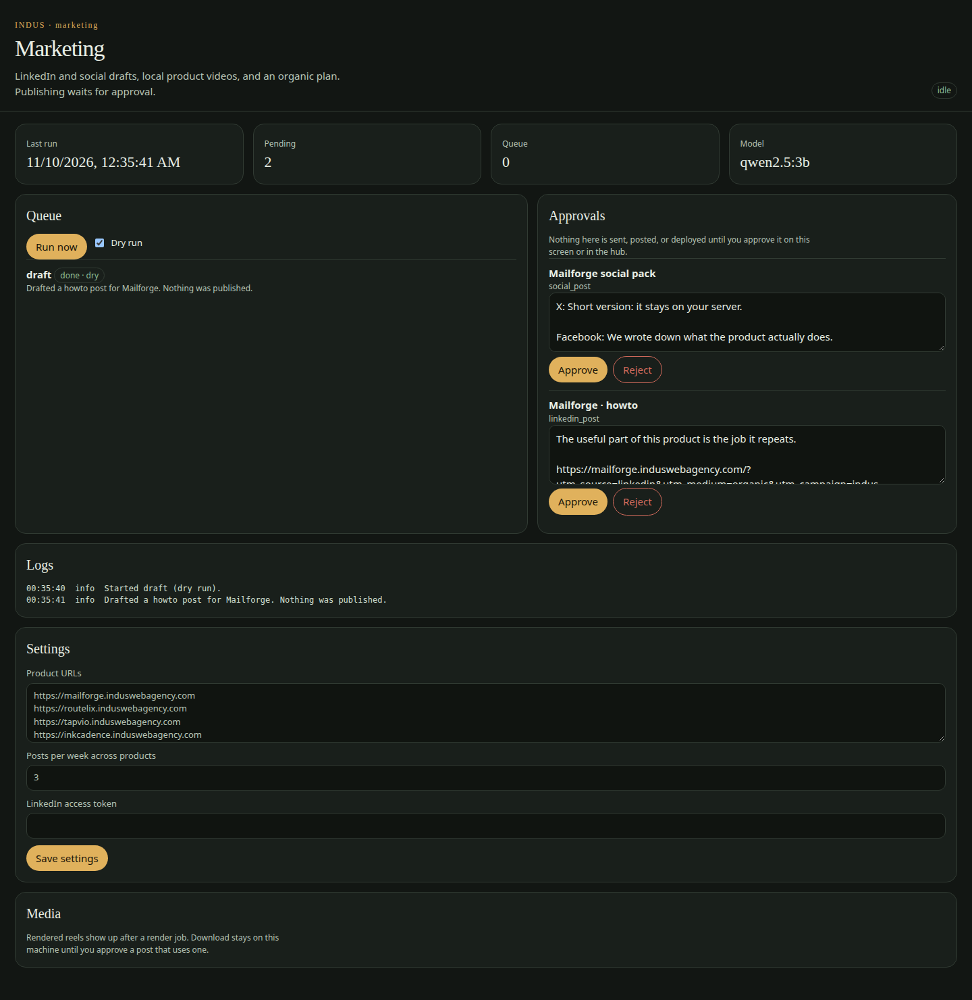

# INDUS Marketing Bot



Marketing reads a product page and optional `llms.txt`, drafts a LinkedIn post in a rotating format, and adds UTM parameters. It can render a vertical reel on the box. X, Facebook, and Reddit are export copy. Reddit is never posted by this bot, even after approval.

This repository is one service from the [INDUS Ops](https://github.com/mafzalkalwardev/indus-ops) monorepo, built for [INDUS Web Agency](https://induswebagency.com). The public hub is [ops.induswebagency.com](https://ops.induswebagency.com). The shared library is [indus-bot-core](https://github.com/mafzalkalwardev/indus-bot-core).

| | |
| --- | --- |
| Repository | [indus-marketing-bot](https://github.com/mafzalkalwardev/indus-marketing-bot) |
| Package | `@indus/marketing-bot` |
| Listens on | `127.0.0.1:41747` |
| Model | Local Ollama by default (`qwen2.5:3b`). No paid API is required. |
| License | [MIT](LICENSE) |

## What it does

- Rotates formats: launch, feature, howto, problem, carousel, showcase.
- Asks the local model for a post and hashtags, then files a `linkedin_post` approval.
- Stamps `utm_source`, `utm_medium=organic`, `utm_campaign=indus-ops`, and `utm_content`.
- Renders a 9:16 reel from a script into the data directory when the task is `render`.
- Files a separate social pack. Without a LinkedIn token, approval exports copy for you to paste.

## What it will not do

- It does not drive the LinkedIn website or post during the draft.
- It does not call LinkedIn until you approve, a time is set, and `LINKEDIN_PUBLISH=1` is on. This build records the approved time.
- It does not auto-post to Reddit.

## Pictures



## Place in the fleet

Commander may queue `draft` or `render`. The sample reel in the monorepo docs was produced by this bot. Content can pass it an article to turn into a post.

Commander may queue safe tasks. Scheduler is the only clock. The hub is the only login. Every service binds to `127.0.0.1`, and nginx publishes only the hub.

## Install and deploy

Install and deploy happen from the monorepo, where this folder sits next to `indus-bot-core`.

```bash
git clone https://github.com/mafzalkalwardev/indus-ops.git
cd indus-ops
npm install
npm test
npm run dev
```

`npm run dev` uses the mock model, so the board works without Ollama. On the VPS:

```bash
sudo bash deploy/install-vps.sh
```

The script installs Ollama, creates the `indus` user, writes `/opt/indus/.env`, and enables one systemd unit per service. Copy `.env.example` to `.env` only for a local run of this package. Do not commit `.env`.

To work on this package by itself, check out the monorepo (the SDK is `file:../indus-bot-core`) and from this directory run:

```bash
npm install
npm test
npm start
```

## Develop

```bash
npm test
```

Tests use Vitest. The service shell, SSO check, SQLite database, and shared LLM lock come from `@indus/bot-core`.

## Settings

Saved from the hub UI. Secrets stay in the service `.env`, never in git.

| Key | What it does |
| --- | --- |
| `products` | Product URLs, one per line. |
| `postsPerWeek` | Posts per week across products. |
| `linkedinToken` | Optional LinkedIn access token with `w_member_social`. |

## Approval rule

Checks, drafts, renders, and analysis run on their own. Mail, campaigns, social posts, quotes that leave the building, deploys, security fixes, translation publishes, and live restores stay in the hub inbox until a person approves them. Reddit is export-only even after approval.

## License

[MIT](LICENSE). Copyright (c) 2026 Muhammad Afzal Kalwar.
