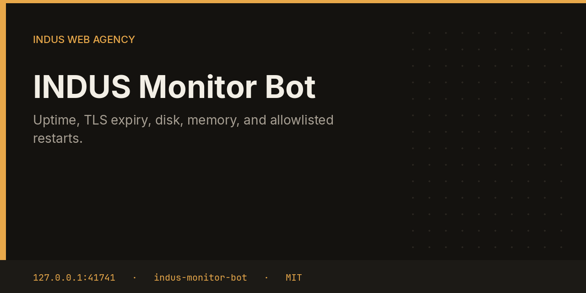
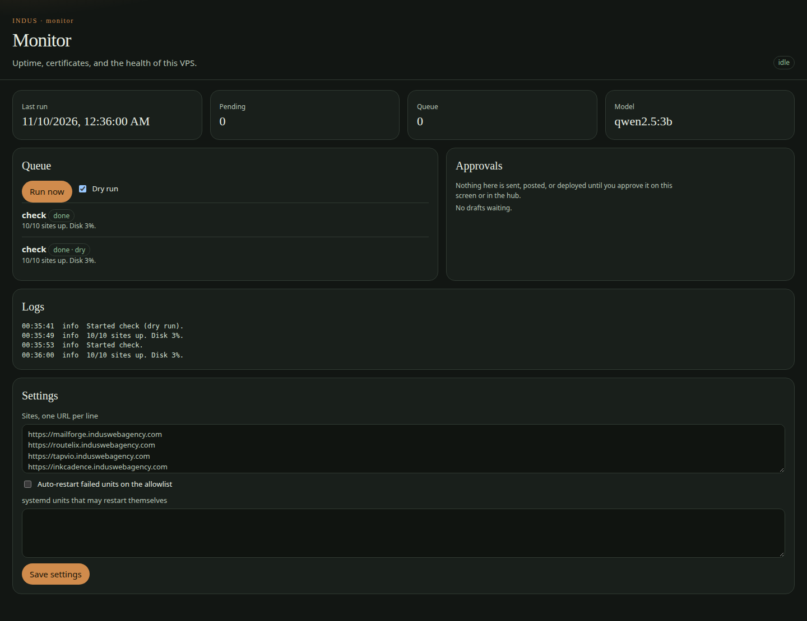

# INDUS Monitor Bot



Monitor checks the sites you list, reads certificate expiry, and samples memory and disk on the VPS. A failed systemd unit is restarted only when it is on your allowlist and you turned auto-restart on. Everything else becomes an approval.

This repository is one service from the [INDUS Ops](https://github.com/mafzalkalwardev/indus-ops) monorepo, built for [INDUS Web Agency](https://induswebagency.com). The public hub is [ops.induswebagency.com](https://ops.induswebagency.com). The shared library is [indus-bot-core](https://github.com/mafzalkalwardev/indus-bot-core).

| | |
| --- | --- |
| Repository | [indus-monitor-bot](https://github.com/mafzalkalwardev/indus-monitor-bot) |
| Package | `@indus/monitor-bot` |
| Listens on | `127.0.0.1:41741` |
| Model | Local Ollama by default (`qwen2.5:3b`). No paid API is required. |
| License | [MIT](LICENSE) |

## What it does

- HTTP-checks each site and records status, latency, and error in SQLite.
- Reads the TLS not-after date for the hostname on port 443.
- Parses `/proc/meminfo` and `df` so the hub can show memory and disk.
- Lists failed systemd units and proposes a restart.
- Restarts a unit immediately only when the name matches a safe pattern, the unit is allowlisted, and auto-restart is on.

## What it will not do

- It will not restart an arbitrary unit. The name must match a short systemd-safe pattern and your allowlist.
- It will not open a public port. The hub proxies the UI.
- It does not page a third-party status vendor.

## Pictures



## Place in the fleet

Commander queues `check` in the morning plan. Reports include the last monitor summary in the daily digest.

Commander may queue safe tasks. Scheduler is the only clock. The hub is the only login. Every service binds to `127.0.0.1`, and nginx publishes only the hub.

## Install and deploy

Install and deploy happen from the monorepo, where this folder sits next to `indus-bot-core`.

```bash
git clone https://github.com/mafzalkalwardev/indus-ops.git
cd indus-ops
npm install
npm test
npm run dev
```

`npm run dev` uses the mock model, so the board works without Ollama. On the VPS:

```bash
sudo bash deploy/install-vps.sh
```

The script installs Ollama, creates the `indus` user, writes `/opt/indus/.env`, and enables one systemd unit per service. Copy `.env.example` to `.env` only for a local run of this package. Do not commit `.env`.

To work on this package by itself, check out the monorepo (the SDK is `file:../indus-bot-core`) and from this directory run:

```bash
npm install
npm test
npm start
```

## Develop

```bash
npm test
```

Tests use Vitest. The service shell, SSO check, SQLite database, and shared LLM lock come from `@indus/bot-core`.

## Settings

Saved from the hub UI. Secrets stay in the service `.env`, never in git.

| Key | What it does |
| --- | --- |
| `sites` | One URL per line. |
| `autoRestart` | Restart failed allowlisted units without waiting. |
| `restartAllowlist` | systemd unit names that may restart themselves. |

## Approval rule

Checks, drafts, renders, and analysis run on their own. Mail, campaigns, social posts, quotes that leave the building, deploys, security fixes, translation publishes, and live restores stay in the hub inbox until a person approves them. Reddit is export-only even after approval.

## License

[MIT](LICENSE). Copyright (c) 2026 Muhammad Afzal Kalwar.
