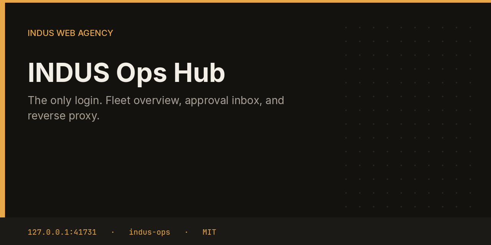
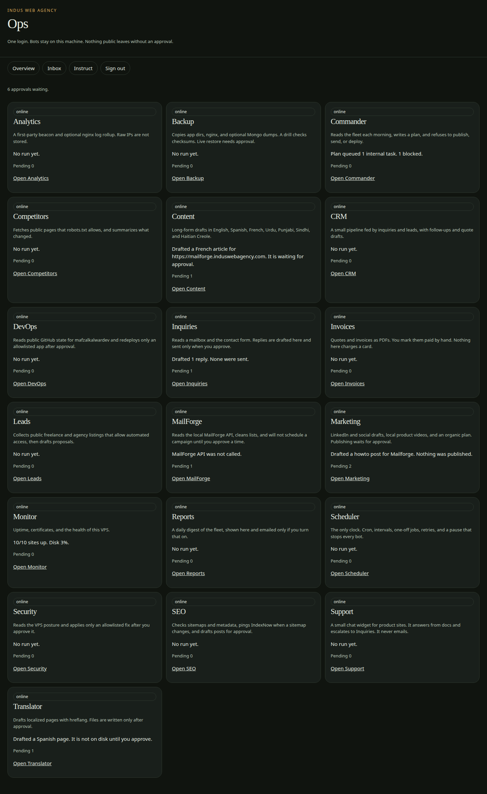
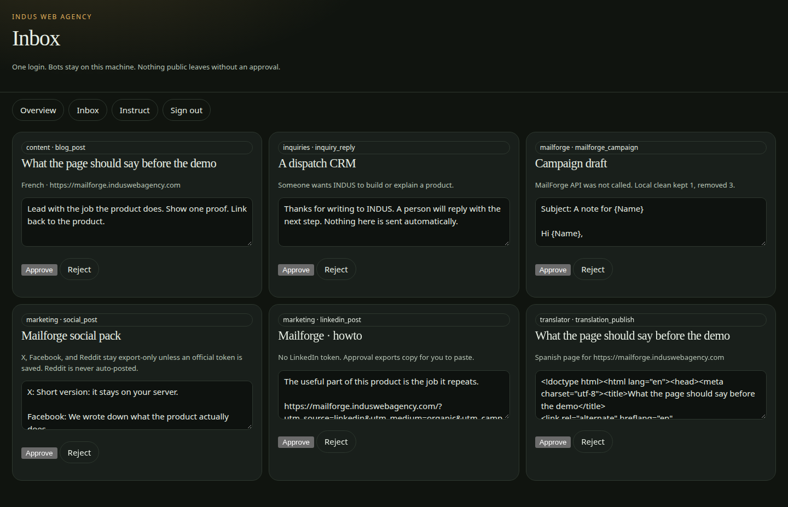
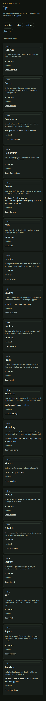

# INDUS Ops Hub



The hub is the only login for the INDUS Ops fleet. It shows every bot, holds the approval inbox, and reverse-proxies each bot UI after you sign in. Nothing that sends mail, posts, deploys, or changes the server leaves this machine until you approve it.

The hub is the `indus-ops/` folder inside the [INDUS Ops](https://github.com/mafzalkalwardev/indus-ops) monorepo, built for [INDUS Web Agency](https://induswebagency.com). It is not a separate GitHub repository. The public site is [ops.induswebagency.com](https://ops.induswebagency.com). The shared library is [indus-bot-core](https://github.com/mafzalkalwardev/indus-bot-core).

| | |
| --- | --- |
| Repository | [indus-ops](https://github.com/mafzalkalwardev/indus-ops) |
| Package | `@indus/ops` |
| Listens on | `127.0.0.1:41731` |
| Model | Local Ollama by default (`qwen2.5:3b`). No paid API is required. |
| License | [MIT](LICENSE) |

## What it does

- Creates the owner once, with the setup token from `deploy/install-vps.sh`.
- Signs the owner in and issues the SSO cookie the other bots trust.
- Lists the fleet, pending approvals, and the last summary from each bot.
- Proxies bot pages at `/bots/<id>/` so operators never open a second login.
- Records an approval before a bot is allowed to send, publish, deploy, or apply a fix.

## What it will not do

- It does not call a paid LLM. The model is local Ollama, or a mock during `npm run dev`.
- It does not bind a public port. nginx on the VPS is the only public site, at `https://ops.induswebagency.com`.
- It does not send mail or post to social networks by itself.

## Pictures







## Place in the fleet

This is the front door. Scheduler owns the clock, Commander writes the morning plan, and every other bot is a separate process that registers with the hub.

Commander may queue safe tasks. Scheduler is the only clock. The hub is the only login. Every service binds to `127.0.0.1`, and nginx publishes only the hub.

## Install and deploy

Install and deploy happen from the monorepo, where this folder sits next to `indus-bot-core`.

```bash
git clone https://github.com/mafzalkalwardev/indus-ops.git
cd indus-ops
npm install
npm test
npm run dev
```

`npm run dev` uses the mock model, so the board works without Ollama. On the VPS:

```bash
sudo bash deploy/install-vps.sh
```

The script installs Ollama, creates the `indus` user, writes `/opt/indus/.env`, and enables one systemd unit per service. Copy `.env.example` to `.env` only for a local run of this package. Do not commit `.env`.

To work on this package by itself, check out the monorepo (the SDK is `file:../indus-bot-core`) and from this directory run:

```bash
npm install
npm test
npm start
```

## Develop

```bash
npm test
```

Tests use Vitest. The service shell, SSO check, SQLite database, and shared LLM lock come from `@indus/bot-core`.

## Approval rule

Checks, drafts, renders, and analysis run on their own. Mail, campaigns, social posts, quotes that leave the building, deploys, security fixes, translation publishes, and live restores stay in the hub inbox until a person approves them. Reddit is export-only even after approval.

## License

[MIT](LICENSE). Copyright (c) 2026 Muhammad Afzal Kalwar.
