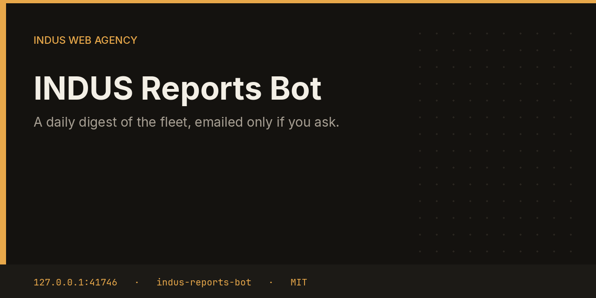

# INDUS Reports Bot



Reports asks the hub for the fleet, then asks each bot for its last state. It writes a markdown digest with the date and the number of approvals waiting, stores it, and emails it only when a recipient is set and email is turned on.

This repository is one service from the [INDUS Ops](https://github.com/mafzalkalwardev/indus-ops) monorepo, built for [INDUS Web Agency](https://induswebagency.com). The public hub is [ops.induswebagency.com](https://ops.induswebagency.com). The shared library is [indus-bot-core](https://github.com/mafzalkalwardev/indus-bot-core).

| | |
| --- | --- |
| Repository | [indus-reports-bot](https://github.com/mafzalkalwardev/indus-reports-bot) |
| Package | `@indus/reports-bot` |
| Listens on | `127.0.0.1:41746` |
| Model | Local Ollama by default (`qwen2.5:3b`). No paid API is required. |
| License | [MIT](LICENSE) |

## What it does

- Calls the hub at `/api/internal/fleet` with the bot token.
- Reads `/api/internal/state` on every bot except itself.
- Counts pending approvals and keeps the last summary line.
- Stores the digest in SQLite.
- Sends the digest through suite SMTP when `emailDigest` is on and a recipient is set.

## What it will not do

- It does not email anyone during a dry run.
- It does not invent status for a bot it could not reach. The line says unreachable.
- It does not approve the items it counts.

## Place in the fleet

Commander queues `digest` after the morning checks. The hub card shows the latest title.

Commander may queue safe tasks. Scheduler is the only clock. The hub is the only login. Every service binds to `127.0.0.1`, and nginx publishes only the hub.

## Install and deploy

Install and deploy happen from the monorepo, where this folder sits next to `indus-bot-core`.

```bash
git clone https://github.com/mafzalkalwardev/indus-ops.git
cd indus-ops
npm install
npm test
npm run dev
```

`npm run dev` uses the mock model, so the board works without Ollama. On the VPS:

```bash
sudo bash deploy/install-vps.sh
```

The script installs Ollama, creates the `indus` user, writes `/opt/indus/.env`, and enables one systemd unit per service. Copy `.env.example` to `.env` only for a local run of this package. Do not commit `.env`.

To work on this package by itself, check out the monorepo (the SDK is `file:../indus-bot-core`) and from this directory run:

```bash
npm install
npm test
npm start
```

## Develop

```bash
npm test
```

Tests use Vitest. The service shell, SSO check, SQLite database, and shared LLM lock come from `@indus/bot-core`.

## Settings

Saved from the hub UI. Secrets stay in the service `.env`, never in git.

| Key | What it does |
| --- | --- |
| `emailDigest` | Send the digest by email. |
| `recipient` | Mailbox that receives the digest. |

## Approval rule

Checks, drafts, renders, and analysis run on their own. Mail, campaigns, social posts, quotes that leave the building, deploys, security fixes, translation publishes, and live restores stay in the hub inbox until a person approves them. Reddit is export-only even after approval.

## License

[MIT](LICENSE). Copyright (c) 2026 Muhammad Afzal Kalwar.
