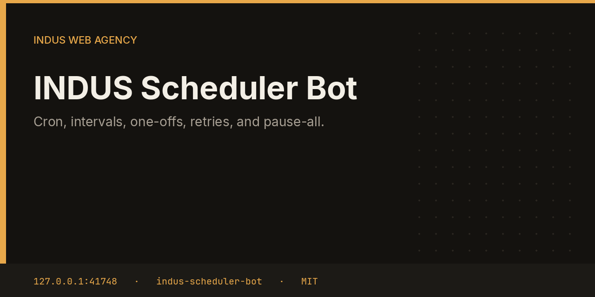

# INDUS Scheduler Bot



Scheduler is the only clock. Bots do not wake themselves on a timer. It runs cron expressions, intervals, and one-off jobs, retries with a 30-second, 2-minute, then 10-minute backoff, and refuses to start the next job when the fleet is paused or a bot is already running.

This repository is one service from the [INDUS Ops](https://github.com/mafzalkalwardev/indus-ops) monorepo, built for [INDUS Web Agency](https://induswebagency.com). The public hub is [ops.induswebagency.com](https://ops.induswebagency.com). The shared library is [indus-bot-core](https://github.com/mafzalkalwardev/indus-bot-core).

| | |
| --- | --- |
| Repository | [indus-scheduler-bot](https://github.com/mafzalkalwardev/indus-scheduler-bot) |
| Package | `@indus/scheduler-bot` |
| Listens on | `127.0.0.1:41748` |
| Model | Local Ollama by default (`qwen2.5:3b`). No paid API is required. |
| License | [MIT](LICENSE) |

## What it does

- Stores jobs with kind `cron`, `interval`, or `once`.
- Keeps one CPU-pool job at a time for `llm` and `video`, and up to two default jobs.
- Will not run a second job for the same bot while one is in flight.
- Computes the following run from the cron expression or the interval.
- Honors pause-all. A paused fleet starts nothing.

## What it will not do

- It does not publish, send, or deploy. It only starts the task name already stored on the job.
- It does not bypass the hub approval gate inside the bot it wakes.
- It does not overlap local model calls. That lock also lives in bot-core.

## Place in the fleet

Every other bot registers work here. Commander queues the morning plan through it. The hub links operators to this service when they want to pause the fleet.

Commander may queue safe tasks. Scheduler is the only clock. The hub is the only login. Every service binds to `127.0.0.1`, and nginx publishes only the hub.

## Install and deploy

Install and deploy happen from the monorepo, where this folder sits next to `indus-bot-core`.

```bash
git clone https://github.com/mafzalkalwardev/indus-ops.git
cd indus-ops
npm install
npm test
npm run dev
```

`npm run dev` uses the mock model, so the board works without Ollama. On the VPS:

```bash
sudo bash deploy/install-vps.sh
```

The script installs Ollama, creates the `indus` user, writes `/opt/indus/.env`, and enables one systemd unit per service. Copy `.env.example` to `.env` only for a local run of this package. Do not commit `.env`.

To work on this package by itself, check out the monorepo (the SDK is `file:../indus-bot-core`) and from this directory run:

```bash
npm install
npm test
npm start
```

## Develop

```bash
npm test
```

Tests use Vitest. The service shell, SSO check, SQLite database, and shared LLM lock come from `@indus/bot-core`.

## Settings

Saved from the hub UI. Secrets stay in the service `.env`, never in git.

| Key | What it does |
| --- | --- |
| `maxRetries` | Retries before the job waits for the next cron slot. |

## Approval rule

Checks, drafts, renders, and analysis run on their own. Mail, campaigns, social posts, quotes that leave the building, deploys, security fixes, translation publishes, and live restores stay in the hub inbox until a person approves them. Reddit is export-only even after approval.

## License

[MIT](LICENSE). Copyright (c) 2026 Muhammad Afzal Kalwar.
