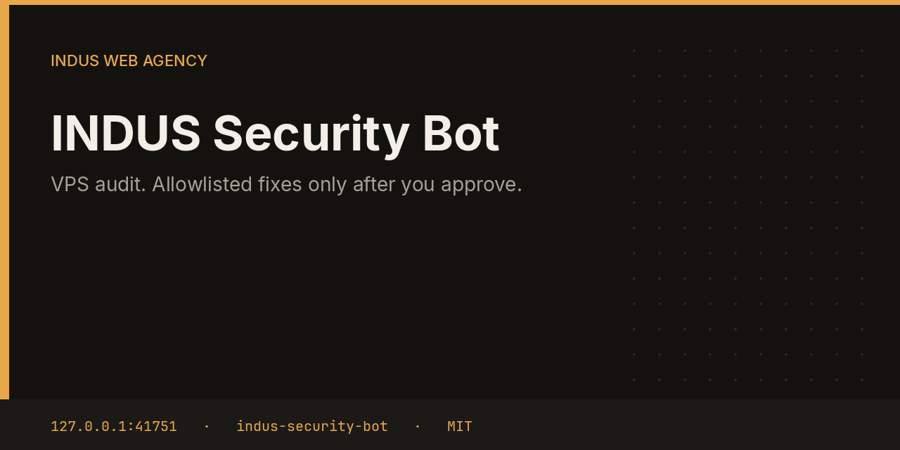

# INDUS Security Bot



Security reads the VPS and files one approval per finding. The only fixes it is willing to apply are `fail2ban-reload` and an nginx security-headers snippet under `/etc/nginx`. Anything else stays a note.

This repository is one service from the [INDUS Ops](https://github.com/mafzalkalwardev/indus-ops) monorepo, built for [INDUS Web Agency](https://induswebagency.com). The public hub is [ops.induswebagency.com](https://ops.induswebagency.com). The shared library is [indus-bot-core](https://github.com/mafzalkalwardev/indus-bot-core).

| | |
| --- | --- |
| Repository | [indus-security-bot](https://github.com/mafzalkalwardev/indus-security-bot) |
| Package | `@indus/security-bot` |
| Listens on | `127.0.0.1:41751` |
| Model | Local Ollama by default (`qwen2.5:3b`). No paid API is required. |
| License | [MIT](LICENSE) |

## What it does

- Runs `sshd -T` and flags `PermitRootLogin yes` and `PasswordAuthentication yes`.
- Notes when `ufw status` cannot be read.
- Lists listening ports other than 22, 80, and 443.
- Mentions recent `lastb` failures and simulated `apt-get` upgrade lines that say security.
- On approval, reloads fail2ban or writes `indus-security-headers.conf` with frame, content-type, referrer, and permissions policies.

## What it will not do

- It will not apply a fix that is not on that two-item allowlist.
- It will not write the nginx snippet outside `/etc/nginx`, and it rejects `..` in the path.
- It does not claim the server was changed while it is only auditing.

## Place in the fleet

Commander queues `audit` before asking other bots to write. Monitor is the one that restarts allowlisted units. Security does not restart services.

Commander may queue safe tasks. Scheduler is the only clock. The hub is the only login. Every service binds to `127.0.0.1`, and nginx publishes only the hub.

## Install and deploy

Install and deploy happen from the monorepo, where this folder sits next to `indus-bot-core`.

```bash
git clone https://github.com/mafzalkalwardev/indus-ops.git
cd indus-ops
npm install
npm test
npm run dev
```

`npm run dev` uses the mock model, so the board works without Ollama. On the VPS:

```bash
sudo bash deploy/install-vps.sh
```

The script installs Ollama, creates the `indus` user, writes `/opt/indus/.env`, and enables one systemd unit per service. Copy `.env.example` to `.env` only for a local run of this package. Do not commit `.env`.

To work on this package by itself, check out the monorepo (the SDK is `file:../indus-bot-core`) and from this directory run:

```bash
npm install
npm test
npm start
```

## Develop

```bash
npm test
```

Tests use Vitest. The service shell, SSO check, SQLite database, and shared LLM lock come from `@indus/bot-core`.

## Settings

Saved from the hub UI. Secrets stay in the service `.env`, never in git.

| Key | What it does |
| --- | --- |
| `snippetDir` | Directory under `/etc/nginx` for the headers snippet. |

## Approval rule

Checks, drafts, renders, and analysis run on their own. Mail, campaigns, social posts, quotes that leave the building, deploys, security fixes, translation publishes, and live restores stay in the hub inbox until a person approves them. Reddit is export-only even after approval.

## License

[MIT](LICENSE). Copyright (c) 2026 Muhammad Afzal Kalwar.
