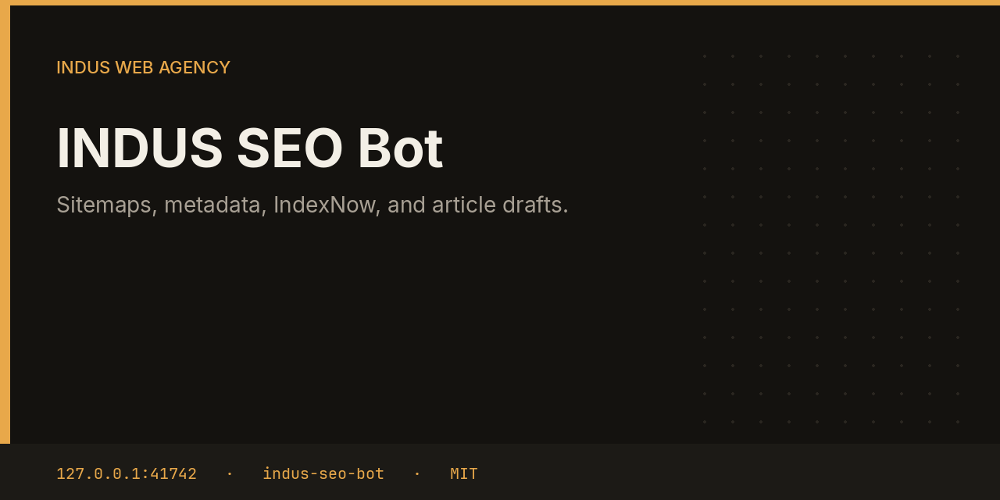

# INDUS SEO Bot



The SEO bot reads a homepage and `sitemap.xml`, reports missing title, meta description, canonical, Open Graph, and JSON-LD, and pings IndexNow when the sitemap hash changes and you have stored a key. It also drafts one short post and leaves it in the inbox.

This repository is one service from the [INDUS Ops](https://github.com/mafzalkalwardev/indus-ops) monorepo, built for [INDUS Web Agency](https://induswebagency.com). The public hub is [ops.induswebagency.com](https://ops.induswebagency.com). The shared library is [indus-bot-core](https://github.com/mafzalkalwardev/indus-bot-core).

| | |
| --- | --- |
| Repository | [indus-seo-bot](https://github.com/mafzalkalwardev/indus-seo-bot) |
| Package | `@indus/seo-bot` |
| Listens on | `127.0.0.1:41742` |
| Model | Local Ollama by default (`qwen2.5:3b`). No paid API is required. |
| License | [MIT](LICENSE) |

## What it does

- Audits title, meta description, canonical, Open Graph title and image, and JSON-LD.
- Parses `sitemap.xml` and stores a sha256 of the URL and lastmod list.
- POSTs to `https://api.indexnow.org/indexnow` only when the hash changed and a key is configured.
- Asks the local model for a blog draft with title, slug, description, and body, then files a `blog_post` approval.

## What it will not do

- It does not publish the draft. Approval stays in the hub.
- It does not call Google Search Console in this build. IndexNow and the on-page audit work without it.
- It does not invent a ranking. It reports what is missing on the page.

## Place in the fleet

Content can hand it an article over the internal ingest API. Marketing and the hub show the pending draft.

Commander may queue safe tasks. Scheduler is the only clock. The hub is the only login. Every service binds to `127.0.0.1`, and nginx publishes only the hub.

## Install and deploy

Install and deploy happen from the monorepo, where this folder sits next to `indus-bot-core`.

```bash
git clone https://github.com/mafzalkalwardev/indus-ops.git
cd indus-ops
npm install
npm test
npm run dev
```

`npm run dev` uses the mock model, so the board works without Ollama. On the VPS:

```bash
sudo bash deploy/install-vps.sh
```

The script installs Ollama, creates the `indus` user, writes `/opt/indus/.env`, and enables one systemd unit per service. Copy `.env.example` to `.env` only for a local run of this package. Do not commit `.env`.

To work on this package by itself, check out the monorepo (the SDK is `file:../indus-bot-core`) and from this directory run:

```bash
npm install
npm test
npm start
```

## Develop

```bash
npm test
```

Tests use Vitest. The service shell, SSO check, SQLite database, and shared LLM lock come from `@indus/bot-core`.

## Settings

Saved from the hub UI. Secrets stay in the service `.env`, never in git.

| Key | What it does |
| --- | --- |
| `sites` | One site per line. Optional `| indexnow-key` after the URL. |

## Approval rule

Checks, drafts, renders, and analysis run on their own. Mail, campaigns, social posts, quotes that leave the building, deploys, security fixes, translation publishes, and live restores stay in the hub inbox until a person approves them. Reddit is export-only even after approval.

## License

[MIT](LICENSE). Copyright (c) 2026 Muhammad Afzal Kalwar.
