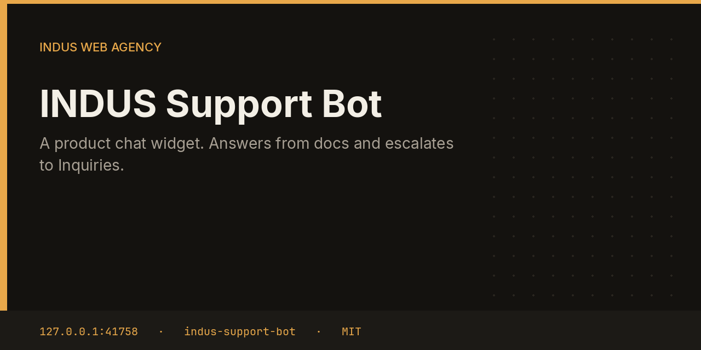

# INDUS Support Bot



Support caches a product doc page, usually `llms.txt`, and answers the widget from those notes. If the question is not grounded in the docs, or the person asks for a human, it escalates to Inquiries. It does not send email.

This repository is one service from the [INDUS Ops](https://github.com/mafzalkalwardev/indus-ops) monorepo, built for [INDUS Web Agency](https://induswebagency.com). The public hub is [ops.induswebagency.com](https://ops.induswebagency.com). The shared library is [indus-bot-core](https://github.com/mafzalkalwardev/indus-bot-core).

| | |
| --- | --- |
| Repository | [indus-support-bot](https://github.com/mafzalkalwardev/indus-support-bot) |
| Package | `@indus/support-bot` |
| Listens on | `127.0.0.1:41758` |
| Model | Local Ollama by default (`qwen2.5:3b`). No paid API is required. |
| License | [MIT](LICENSE) |

## What it does

- Fetches the first docs URL and stores up to 20,000 characters locally.
- Answers with the local model and a JSON `{ answer, escalate }` shape.
- Sets escalate when the caller asked for a person or the question shares no meaningful words with the docs.
- Posts an escalation to the Inquiries ingest route.
- Serves the widget script the hub exposes for product sites.

## What it will not do

- It does not invent prices.
- It does not email the visitor.
- It does not answer from an empty cache as if it had read the product.

## Place in the fleet

Embed `<script src="https://ops.induswebagency.com/public/support/widget.js" data-endpoint="https://ops.induswebagency.com/public/support"></script>` on a product site. Escalations show up in Inquiries for a drafted reply.

Commander may queue safe tasks. Scheduler is the only clock. The hub is the only login. Every service binds to `127.0.0.1`, and nginx publishes only the hub.

## Install and deploy

Install and deploy happen from the monorepo, where this folder sits next to `indus-bot-core`.

```bash
git clone https://github.com/mafzalkalwardev/indus-ops.git
cd indus-ops
npm install
npm test
npm run dev
```

`npm run dev` uses the mock model, so the board works without Ollama. On the VPS:

```bash
sudo bash deploy/install-vps.sh
```

The script installs Ollama, creates the `indus` user, writes `/opt/indus/.env`, and enables one systemd unit per service. Copy `.env.example` to `.env` only for a local run of this package. Do not commit `.env`.

To work on this package by itself, check out the monorepo (the SDK is `file:../indus-bot-core`) and from this directory run:

```bash
npm install
npm test
npm start
```

## Develop

```bash
npm test
```

Tests use Vitest. The service shell, SSO check, SQLite database, and shared LLM lock come from `@indus/bot-core`.

## Settings

Saved from the hub UI. Secrets stay in the service `.env`, never in git.

| Key | What it does |
| --- | --- |
| `docs` | `llms.txt` or other documentation URLs. |

## Approval rule

Checks, drafts, renders, and analysis run on their own. Mail, campaigns, social posts, quotes that leave the building, deploys, security fixes, translation publishes, and live restores stay in the hub inbox until a person approves them. Reddit is export-only even after approval.

## License

[MIT](LICENSE). Copyright (c) 2026 Muhammad Afzal Kalwar.
