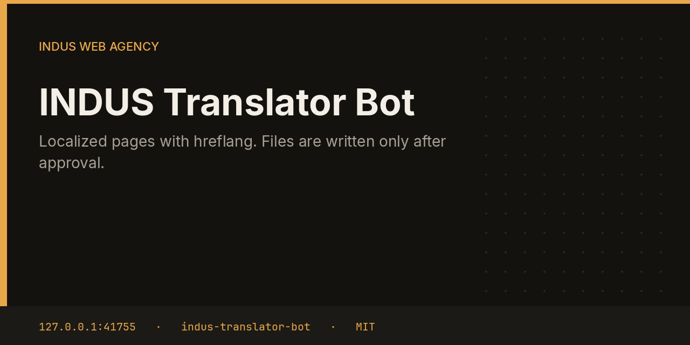

# INDUS Translator Bot



Translator fetches a page, drafts a localized version, and wraps it in HTML with `hreflang` alternates for every agency language plus `x-default`. The file stays in the approval until you accept it. Only then is it written under the publish directory.

This repository is one service from the [INDUS Ops](https://github.com/mafzalkalwardev/indus-ops) monorepo, built for [INDUS Web Agency](https://induswebagency.com). The public hub is [ops.induswebagency.com](https://ops.induswebagency.com). The shared library is [indus-bot-core](https://github.com/mafzalkalwardev/indus-bot-core).

| | |
| --- | --- |
| Repository | [indus-translator-bot](https://github.com/mafzalkalwardev/indus-translator-bot) |
| Package | `@indus/translator-bot` |
| Listens on | `127.0.0.1:41755` |
| Model | Local Ollama by default (`qwen2.5:3b`). No paid API is required. |
| License | [MIT](LICENSE) |

## What it does

- Fetches the first configured page, or MailForge's public site when none is set.
- Asks the local model for a title and translation.
- Builds a small HTML document with alternate links such as `?lang=es`.
- Files a `translation_publish` approval.
- On approval, writes the file under the configured publish directory.

## What it will not do

- It does not write the file during the draft, including during a dry run.
- It does not publish to a remote CMS.
- It does not claim the page is live on the origin.

## Place in the fleet

Content drafts the long article. Translator drafts the localized page. Both wait on the same hub inbox.

Commander may queue safe tasks. Scheduler is the only clock. The hub is the only login. Every service binds to `127.0.0.1`, and nginx publishes only the hub.

## Install and deploy

Install and deploy happen from the monorepo, where this folder sits next to `indus-bot-core`.

```bash
git clone https://github.com/mafzalkalwardev/indus-ops.git
cd indus-ops
npm install
npm test
npm run dev
```

`npm run dev` uses the mock model, so the board works without Ollama. On the VPS:

```bash
sudo bash deploy/install-vps.sh
```

The script installs Ollama, creates the `indus` user, writes `/opt/indus/.env`, and enables one systemd unit per service. Copy `.env.example` to `.env` only for a local run of this package. Do not commit `.env`.

To work on this package by itself, check out the monorepo (the SDK is `file:../indus-bot-core`) and from this directory run:

```bash
npm install
npm test
npm start
```

## Develop

```bash
npm test
```

Tests use Vitest. The service shell, SSO check, SQLite database, and shared LLM lock come from `@indus/bot-core`.

## Settings

Saved from the hub UI. Secrets stay in the service `.env`, never in git.

| Key | What it does |
| --- | --- |
| `pages` | Canonical pages to translate. |
| `publishDir` | Directory that receives the file after approval. |

## Approval rule

Checks, drafts, renders, and analysis run on their own. Mail, campaigns, social posts, quotes that leave the building, deploys, security fixes, translation publishes, and live restores stay in the hub inbox until a person approves them. Reddit is export-only even after approval.

## License

[MIT](LICENSE). Copyright (c) 2026 Muhammad Afzal Kalwar.
